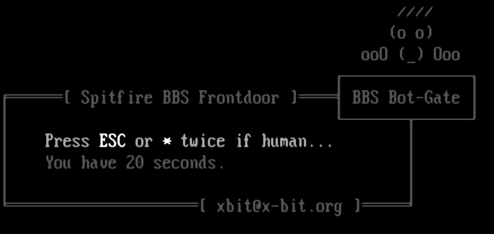

# BotGate v2.4.2

  

A TCP-level bot gate for BBS systems. BotGate sits in front of your BBS's real telnet port and requires each caller to press ESC and/or `*` twice within a configurable timeout before your actual BBS software ever sees the connection. Callers who don't respond — or who are obviously automated rather than human — are disconnected without ever reaching the BBS.

Originally built to protect a Spitfire BBS node running behind a NetSerial virtual-modem bridge, but it works with any BBS reachable over telnet (Synchronet, Mystic, WWIV, Spitfire, or anything else), since it operates purely at the TCP/telnet level with no dependency on, or awareness of, what's actually running behind it.

## Features

- Multi-listener support (2.3+) — protect more than one app (a second BBS node, a door, a plain telnet service) from a single BotGate process, each on its own port with its own backend and optional prompt screen
- ESC/`*` challenge gate — configurable timeout and required hit count
- Custom ANSI/ASCII prompt screens, with a live per-second countdown
- Optional local startup banner for the sysop's own console — never shown when piped/logged/under a service manager
- Synchronet-style `.can` blocklist support — IP, CIDR, wildcard, and hostname patterns, with an always-allow exempt list
- Managed `can/abuseipdb.can` IPv4 reputation feed — refreshes in the background every 12 hours by default, with cached protection and logged update results
- Geo-blocking via IP2Location-format `.htaccess` lists, auto-loaded from a folder — no config changes needed to add a country
- Reverse-DNS hostname matching, with a hard timeout and fail-open behavior so legitimate callers are never blocked over a slow or missing PTR record
- Per-IP simultaneous connection cap, plus a global cap across all IPs combined for flood protection
- Automatic rate-limiting with a self-managed, human-readable temporary ban file
- Optional PROXY protocol support, so backends like Synchronet (with `HAPROXY_PROTO` enabled) can still see the real caller's IP for their own filtering and logs
- Pure Python 3 standard library — no third-party dependencies, runs on Linux, Windows, and macOS

## Getting Started

**Fixed in v2.4.2:** IPv6 entries in a geo blocklist no longer crash BotGate
at startup. They are skipped with one warning per affected file, while valid
IPv4 ranges remain active. BotGate continues to listen on IPv4 only.
No configuration changes are required. See [PR #3](https://github.com/xbit44/botgate/pull/3).

See **[quick-install.md](quick-install.md)** for the bare-minimum steps to get running, and **[botgate.md](botgate.md)** for the full user guide — every configuration option, feature walkthroughs, and troubleshooting.

### What's new in v2.4.2

- Fixed an `OverflowError` at startup when a geo file contains IPv6 ranges.
- Logs the number of skipped IPv6 ranges and the affected file once at startup.
- Added a regression test for mixed IPv4/IPv6 geo files; the suite contains
  44 tests. The owner also passed live production testing on unix-bit.

### Fixed in v2.4.1

- Fixed custom ANSI countdown numbers reverting to the prompt's ending color
  during updates. Foreground/background colors and attributes active at `##`
  are honored, including formatting carried over from an earlier line.
- Added regression checks for colored countdowns, resets, plain/static prompts,
  and successive updates over real sockets. That release brought the suite to
  43 tests. See [issue #2](https://github.com/xbit44/botgate/issues/2).

### Added in v2.4

- Managed AbuseIPDB feed shared by all listeners, with background refreshes.
- Complete snapshot replacement: additions and removals take effect without a
  restart. Failed updates retain the last valid cache and active list.
- INFO update results and WARNING feed-block messages identifying the listener.
- Automated syntax, unit, socket, and process checks on Linux, Windows, and macOS
  using Python 3.12. See [tests/README.md](tests/README.md).

Under `[proxy]`, `abuseipdb update = 12` enables a shared feed refresh every
12 hours. Set it to `0` to disable both downloads and blocking from this feed.
An existing config without this setting also defaults to `12`.

BotGate uses a valid local cache immediately, then checks for an update in the
background after listeners start. Successful refreshes replace the snapshot
live, so removed addresses stop being blocked by this feed. Failures retain the
last valid list. Update results and failures log at INFO; feed blocks log at WARNING.

This downloads the public [borestad 30-day IPv4 list](https://raw.githubusercontent.com/borestad/blocklist-abuseipdb/refs/heads/main/abuseipdb-s100-30d.ipv4)
over HTTPS. It does not call the AbuseIPDB API or need an API key.
`can/abuseipdb.can` is created at runtime and is not bundled. Do not edit it
manually; use the normal local block/exempt files. See [Section 7a](botgate.md#7a-managed-abuseipdb-feed)
for details.

**Upgrading from v2.4 or v2.4.1:** stop BotGate, back up the working script,
replace only `botgate_proxy.py`, then restart. Keep your production settings,
prompts, and blocklists; no config changes are required for v2.4.2.
If upgrading from before v2.4, review the commented managed-feed setting in the
sample config under `[proxy]`. Older configs default to 12 hours;
`abuseipdb update = 0` disables the feed.

## Credits

Telnet protocol negotiation handling — the IAC constants, the `send_initial_telnet_options()` negotiation function — was adapted near-verbatim from the [ANetBBS Selector](https://github.com/anetonline/ANetBBS-Selector) project. Thank you to its author for sharing the source.

Thanks also to [Digital Man](https://www.synchro.net/) of the Synchronet project, whose `.can`-file filtering conventions inspired BotGate's own blocklist format and the concept behind its IAC-stripping input filter.

The managed reputation feed is maintained by [borestad/blocklist-abuseipdb](https://github.com/borestad/blocklist-abuseipdb)
using AbuseIPDB-derived data. Its upstream comments credit [AbuseIPDB](https://www.abuseipdb.com/)
and [IPinfo](https://ipinfo.io/).

Thanks to [Snowblind350](https://github.com/Snowblind350) for the IPv6 geo-file
startup fix and its regression test in [PR #3](https://github.com/xbit44/botgate/pull/3).

## License

MIT — see [LICENSE](LICENSE).
